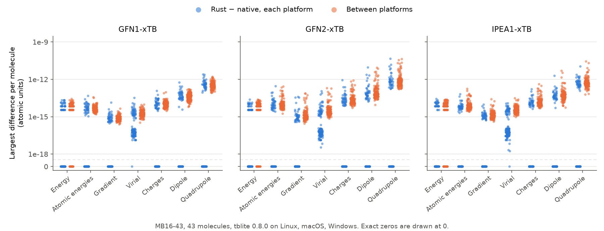

# tblite-rs

[](https://github.com/choutkaj/tblite-rs/actions/workflows/ci.yml?query=branch%3Amain)
[](https://docs.rs/tblite)

Rust bindings to [tblite](https://github.com/tblite/tblite) 0.8, which provides
GFN1-xTB, GFN2-xTB and IPEA1-xTB. `tblite-sys` declares all 123 public C
functions. `tblite` wraps them in a safe API that owns every native object. The
bindings are AI-generated and tested against native tblite.

## Install

```toml
[dependencies]
tblite = "0.2.0"
```

Cargo does not build tblite. Set `TBLITE_DIR` to a tblite 0.8 installation:
a [runtime bundle](#runtime-bundles) or [your own build](#building-tblite).
Without `TBLITE_DIR`, the build script asks pkg-config. Requires Rust 1.85 or later.

## Example

```rust
use tblite::{Calculator, Method, Structure};

fn main() -> tblite::Result<()> {
    let water = Structure::from_angstrom(&[8, 1, 1], &[
        [0.0, 0.0, 0.0],
        [0.0, 0.0, 0.96],
        [0.92, 0.0, -0.24],
    ])?;
    let mut calculator = Calculator::new(water, Method::Gfn2)?;
    let result = calculator.singlepoint()?;
    let energy = result.energy()?; // Hartree
    let gradient = result.gradient()?; // Hartree/Bohr, one row per atom
    assert!((energy + 5.070318054910).abs() < 1e-8);
    println!("{energy:.10} Eh\n{gradient:?}");
    Ok(())
}
```

More in [`tblite/examples`](tblite/examples). The [API documentation](https://docs.rs/tblite)
lists units, array layouts and threading rules.

## Runtime bundles

Each [release](https://github.com/choutkaj/tblite-rs/releases) attaches tblite
0.8.0 as a shared library that an application can ship:

| Asset | Runs on | Built with |
| --- | --- | --- |
| `tblite-0.8.0-windows-x86_64.tar.gz` | Windows 10 and later | MSYS2 UCRT64: GCC 16.2, OpenBLAS |
| `tblite-0.8.0-linux-x86_64.tar.gz` | glibc 2.28 and later (RHEL 8, Ubuntu 20.04) | conda-forge: GCC 16.2, OpenBLAS |
| `tblite-0.8.0-macos-aarch64.tar.gz` | macOS 11 and later on Apple silicon | conda-forge: GNU Fortran 16.2, Clang 23.1, OpenBLAS, LLVM OpenMP |

Each archive holds one folder, named after the platform:

```text
lib/             tblite and every non-system library it loads
licenses/        the licence of each library
SOURCES.md       version, checksum, source and build settings of every file
include/         headers, for building
lib/pkgconfig/   tblite.pc, for building
```

The bundles have ddX, but not HDF5, TREXIO or MPI. An application ships
`lib/`, `licenses/` and `SOURCES.md` and points its loader at `lib/`:

| Platform | Loader setup |
| --- | --- |
| Windows | Put the DLLs next to the executable. |
| Linux | RUNPATH `$ORIGIN/lib`: `RUSTFLAGS='-C link-arg=-Wl,-rpath,$ORIGIN/lib'` |
| macOS | rpath `@executable_path/lib`. Sign the dylibs with your identity, then the app. |

For `cargo test` against a bundle, put `lib/` on `PATH` (Windows) or
`LD_LIBRARY_PATH` (Linux). On macOS, add the rpath `$TBLITE_DIR/lib` to both
`RUSTFLAGS` and `RUSTDOCFLAGS`. `OMP_NUM_THREADS` sets tblite's threads and
`OPENBLAS_NUM_THREADS` OpenBLAS's.

`tools/bundle-native.py` builds the bundles from the toolchains pinned in
`tools/bundle/`; see `--help`.

## Building tblite

`tools/build-native.py` builds tblite 0.8.0 with Meson from the checksummed
release and the dependency commits of its wraps. It patches one known bug: 13 C
functions are declared `PUBLIC` so that GNU Fortran exports them on macOS
([GCC PR126872](https://gcc.gnu.org/bugzilla/show_bug.cgi?id=126872)).

<details>
<summary>Linux (Debian, Ubuntu)</summary>

```sh
sudo apt-get install gfortran gcc g++ libopenblas-dev libhdf5-dev python3 meson ninja-build git pkg-config
FC=gfortran CC=gcc CXX=g++ python3 tools/build-native.py --prefix "$PWD/.native/install" --library both
export TBLITE_DIR="$PWD/.native/install" LD_LIBRARY_PATH="$PWD/.native/install/lib"
```

</details>

<details>
<summary>macOS (Homebrew)</summary>

```sh
brew install gcc openblas hdf5 libaec meson ninja pkgconf python git
export FC="$(brew --prefix gcc)/bin/gfortran" CC=clang CXX=clang++
export MACOSX_DEPLOYMENT_TARGET="$(sw_vers -productVersion | cut -d. -f1,2)"
export PKG_CONFIG_PATH="$(brew --prefix openblas)/lib/pkgconfig:$(brew --prefix hdf5)/lib/pkgconfig"
export LIBRARY_PATH="$(brew --prefix libaec)/lib" PATH="$(brew --prefix hdf5)/bin:$PATH"
python3 tools/build-native.py --prefix "$PWD/.native/install" --library both
export TBLITE_DIR="$PWD/.native/install" DYLD_LIBRARY_PATH="$PWD/.native/install/lib"
```

</details>

<details>
<summary>Windows (MSVC Rust, MSYS2 tblite)</summary>

In an MSYS2 UCRT64 shell:

```sh
pacman -S --needed git mingw-w64-ucrt-x86_64-gcc-fortran mingw-w64-ucrt-x86_64-meson \
    mingw-w64-ucrt-x86_64-ninja mingw-w64-ucrt-x86_64-openblas mingw-w64-ucrt-x86_64-hdf5
FC=gfortran CC=gcc CXX=g++ python tools/build-native.py --prefix "$PWD/.native/install" --library shared
```

Then in PowerShell, which needs the MSVC build tools:

```powershell
./tools/windows-import-library.ps1 -Prefix .native/install
$env:TBLITE_DIR = (Resolve-Path .native/install).Path
$env:PATH = "$env:TBLITE_DIR\bin;C:\msys64\ucrt64\bin;$env:PATH"
```

</details>

`--minimal` builds without ddX and HDF5, `--hdf5 disabled` without HDF5 alone.
`tblite::has_feature` reports what the loaded library has.

The `static` feature links tblite statically on Linux and macOS. Use it for
development only, and distribute tblite as a shared library.

## Validation

The tests compare energies with tblite's own reference values, gradients and
strain derivatives with finite differences, and cover ownership, callbacks and
restarts. CI runs them on Linux, macOS and Windows.

The MB16-43 benchmark calculates 43 molecules with each method through the
native tblite program and through the Rust API, 129 pairs per platform. All pass
on the three bundles. Rust and native differ no more than the platforms differ
from each other:



[Pass bounds, settings and per-platform reports](benchmarks/mb16-43/README.md).

## Licence

The Rust code is MIT OR Apache-2.0. tblite and its headers are
LGPL-3.0-or-later; see [NOTICE.md](NOTICE.md). An application that ships
tblite must:

- keep tblite and libquadmath replaceable shared libraries, as the bundles are;
- ship the licences and `SOURCES.md`, and state that it uses tblite under the LGPL;
- allow users to modify these libraries and to reverse engineer the
  application to debug such changes (LGPL-3.0 section 4);
- give recipients the source of the LGPL libraries; `SOURCES.md` lists it.

[Changelog](CHANGELOG.md) · [Contributing](CONTRIBUTING.md)
