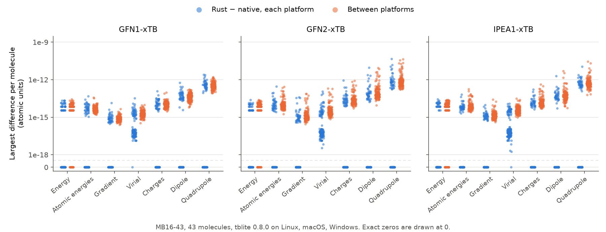

# MB16-43 parity

The native tblite program and the Rust API calculate the 43 target structures of
MB16-43 with GFN1-xTB, GFN2-xTB and IPEA1-xTB: 129 independent single points
each. The structures have 16 atoms from H to Cl and are neutral; 22 have one
unpaired electron. The benchmark tests the bindings, not the methods.



| Platform | Report |
| --- | --- |
| Windows x86-64, MSVC Rust | [results/windows](results/windows/README.md) |
| Linux x86-64, under WSL | [results/linux](results/linux/README.md) |
| macOS arm64, in CI | [results/macos](results/macos/README.md) |

Each report uses that platform's runtime bundle. A pair passes when every
component differs by less than:

| Property | Bound |
| --- | --- |
| Total and atomic energies | 1e-8 Eh |
| Gradient | 1e-7 Eh/Bohr |
| Virial | 1e-6 Eh |
| Charges | 1e-6 e |
| Dipole | 1e-5 e Bohr |
| Quadrupole | 1e-4 e Bohr² |

Both routes use the SAD guess, accuracy 0.01, at most 250 SCF iterations, one
spin channel with alpha and beta occupations, one thread and a new directory
per case. The electronic temperature is 300 K times 3.166808578545117e-6 Eh/K,
the constant of the tblite program; `set_temperature_kelvin` uses a slightly
different one. [CONTRIBUTING.md](../../CONTRIBUTING.md#benchmark) shows how to
run it.

## Structures

`structures.json` transcribes `mindless01` to `mindless43` from
[mstore `src/mstore/mb16_43.f90`](https://github.com/grimme-lab/mstore/blob/663245d739be0123da61c917e55116b0c3db4c74/src/mstore/mb16_43.f90)
(SHA-256 of the LF file `4281f4e7f39c514ed449de49ee255b698b1a7d410f0625553e9b70c0893228a6`),
in Bohr, with the original atom order, charges and spins. The source and the
transcription are Apache-2.0. To regenerate it:

```sh
curl -fsSL -o .native/mb16_43.f90 \
  https://raw.githubusercontent.com/grimme-lab/mstore/663245d739be0123da61c917e55116b0c3db4c74/src/mstore/mb16_43.f90
python3 tools/benchmark_parity.py prepare .native/mb16_43.f90
```
